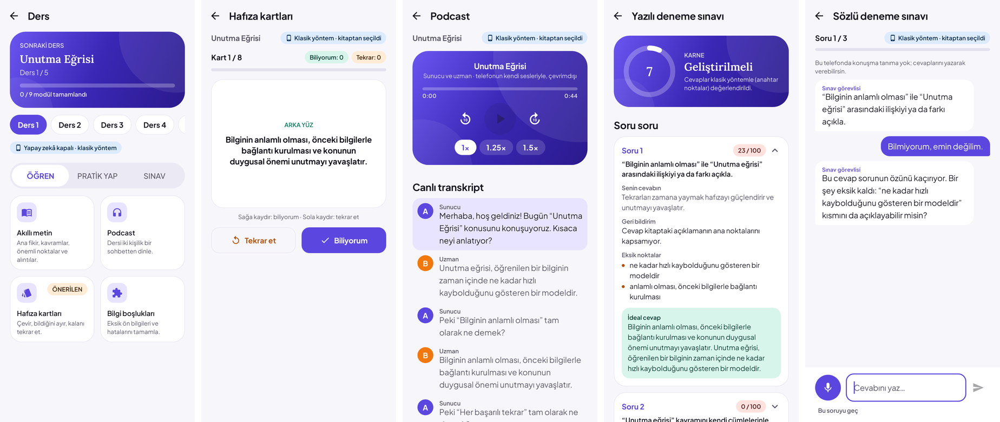

# Sonraki ders: Öğren · Pratik yap · Sınav

Kitabın her bölümü bir **ders**tir. Kitap sayfasındaki "Sonraki ders" kartı, henüz tamamlanmamış ilk derse açılır
(ders, testi ya da sınavlardan biri bitince tamamlanmış sayılır). Ders ekranında üç sekme vardır:

| Sekme | Modül | Ne yapar |
|---|---|---|
| ÖĞREN | Akıllı metin | Ana fikir, 4–6 anahtar kavram, önemli noktalar, kitaptan birebir 1–2 alıntı (kitapta doğrulanır), akılda kalsın notu; sesli dinlenebilir |
| | Podcast | Sunucu (A) ve uzman (B) arasında 10–14 satırlık sohbet; telefonun kendi TTS sesleriyle (iki ses varsa iki ses, yoksa farklı ton/hız), ±10 sn, 1× / 1,25× / 1,5×, konuşulan satırı ve kelimeyi izleyen canlı transkript, satıra dokunarak atlama |
| | Hafıza kartları (ÖNERİLEN) | 8 kart, 3B çevirme; sağa kaydır = biliyorum, sola kaydır = tekrar et (kart tekrar kuyruğuna, hemen vadeli) |
| | Bilgi boşlukları | Test/sınav hataların varsa onlardan, yoksa dersin dayandığı ön bilgilerden (önceki bölümlerin kavramları) kısa tamamlama kartları |
| PRATİK YAP | Alıştırma | Boşluk doldurma (4 seçenek, Türkçe ek korunur: "_____nın") ve kavram eşleştirme |
| | Test | A–D çoktan seçmeli, makul çeldiriciler, her soruda tek cümlelik açıklama |
| | Doğru / Yanlış | Yarısı doğru, yarısı ince bir ayrıntısı değiştirilmiş ifadeler; cevap anında açıklanır |
| | Tekrar | Mevcut aralıklı tekrar ekranı (FSRS); bu dersteki tüm yanlışlar buraya düşer |
| SINAV | Yazılı deneme sınavı | 3/5/10 açık uçlu soru + zorluk; cevaplar **tek tek** puanlanır (0–100, eksik noktalar, geri bildirim, ideal cevap) → karne |
| | Sözlü deneme sınavı | Soru sesli okunur → mikrofon açılır → cevap metne çevrilir → model en fazla 2 cümleyle değerlendirir; bir önemli nokta eksikse **bir** kısa ek soru sorar, sonra puan verip sıradaki soruya geçer; sonunda sözlü puan |

## Yapay zekâ nasıl kullanılıyor

- **Model:** Google Gemini API (`ai-config.properties` içindeki model; bkz. [GEMINI.md](GEMINI.md)). Anahtarsız derlemede
  ya da yapay zekâ kapalıyken her modül klasik yöntemle üretilir. (İlk sürüm cihaz içi LiteRT-LM modeliyle yazılmıştı;
  küçük modeller için konan korumalar — bağlam bütçesi, JSON onarımı, talimat tekrarı filtresi — Gemini'de de çalışır.)
- **İstemler:** `core/.../ai/study/LearningPrompts.kt` — her modül için tek görev, birebir JSON örneği, sabit adet ve kısa
  alanlar. Şemalar `StudyModels.kt` içindedir (ör. podcast `{"title","lines":[{"speaker":"A","text":"…"}]}`, test
  `{"questions":[{"question","options":[4],"answer":0-3,"explanation"}]}`).
- **Bağlam bütçesi:** ders metni sağlayıcının istem bütçesine sığmazsa `ContextPacker` metni kesmek yerine TextRank ile
  en merkezi cümleleri kitap sırasıyla seçer (Gemini'nin bütçesi geniş olduğundan pratikte nadiren gerekir).
- **JSON temizleyici:** `JsonSanitizer` markdown çitlerini, BOM'u, açıklama metnini, sondaki virgülleri temizler; çıplak
  diziyi beklenen nesneye sarar (`[…]` → `{"cards":[…]}`), kesilen çıktıyı kapatır. Küçük modellerin farklı yazımları
  kabul edilir: `"answer":"C"` / `"2"` / seçenek metni → indeks; `"isTrue":"Doğru"` → `true`; konuşmacı adları
  ("Sunucu", "Uzman") → A/B.
- **Talimat tekrarı:** küçük modeller bazen talimatı cevaba kopyalar (emülatörde Qwen3 0.6B bir karta "Create 8
  flashcards…" yazdı). Talimatlardan art arda 5 kelime tekrarlayan ya da hiç kelime içermeyen her öğe atılır; geriye
  yeterli öğe kalmazsa düzeltici deneme ve ardından klasik yöntem devreye girer.
- **Doğrulama ve yedek:** çıktı doğrulanır (ör. podcast ≥4 satır, test seçenekleri tekil ve cevap indeksi geçerli,
  alıntılar kitapta geçmeli). Geçersizse bir düzeltici deneme yapılır; yine olmazsa ya da model yoksa aynı modül
  **klasik yöntemle** (TextRank, kavram çıkarma, kural tabanlı soru üretici ve puanlayıcı) üretilir ve ekranda
  "klasik yöntem" etiketi/uyarısı görünür. Uygulama çökmez; ücretli bir servise asla geçilmez.
- **Önbellek:** model çıktıları (not, podcast, kartlar, sorular) önbelleğe alınır; sınav soruları, puanlama, sözlü sınav
  ve hata kaynaklı boşluklar her seferinde yeniden üretilir.
- **Sözlü sınavda hız:** değerlendirme istemi 150 token ile sınırlıdır, cevap en fazla 2 cümleye kısaltılır. Akış
  (streaming) kullanılmadı: kısa cevap tek parça gelir ve TTS'e doğrudan verilir.

## Ses

- **Konuşma (TTS):** `audio/PodcastPlayer.kt` telefonun yerleşik TextToSpeech motorunu kullanır (ücretsiz, ses paketi
  yüklüyse çevrimdışı). Süre motor tarafından bildirilmediği için metinden tahmin edilir (1×'te ~14 karakter/sn);
  ileri/geri atlama kelime başına hizalanır.
- **Konuşma tanıma (STT):** `audio/SpeechInput.kt` Android 12+ telefonlarda tamamen cihaz içi tanıyıcıyı, diğerlerinde
  sistem tanıyıcısını "çevrimdışı tercih et" ile kullanır. Mikrofon izni yalnızca sözlü sınav başlarken istenir.
  Tanıma yoksa ya da izin verilmezse cevap yazılarak verilir.

## Tekrar ile bağlantı

Hafıza kartında "Tekrar et", alıştırma/test/D-Y yanlışları ve 60 puanın altındaki sınav cevapları
`ReviewRepository.ensureItem(..., dueNow = true)` ile tekrar kuyruğuna (WRONG_ANSWER) girer. Bilgi boşlukları modülü bu
kayıtları ve "tekrar" olarak derecelendirilen kartları dersin hataları olarak okur.

## Dosyalar

| Katman | Dosya |
|---|---|
| Veri modelleri ve şemalar | `core/src/main/kotlin/com/bookmind/core/ai/study/StudyModels.kt` |
| İstem şablonları | `core/.../ai/study/LearningPrompts.kt` |
| Model + doğrulama + yedek | `core/.../ai/study/StudyAi.kt`, `StudyFallbacks.kt`, `core/.../ai/JsonSanitizer.kt` |
| Ders, ilerleme, tekrar bağlantısı | `app/.../data/repo/StudyHubRepository.kt` |
| Ses | `app/.../audio/PodcastPlayer.kt`, `app/.../audio/SpeechInput.kt` |
| Ekranlar | `app/.../ui/study/StudyHubScreen.kt`, `StudyModuleScreen.kt`, `ExamScreens.kt`, `StudyViewModels.kt` |
| Testler | `core/src/test/.../ai/study/StudyAiTest.kt`, `app/src/test/.../ui/StudyHubUiTest.kt`, `scripts/android-smoke.sh` |

Video modülü kapsam dışıdır.
